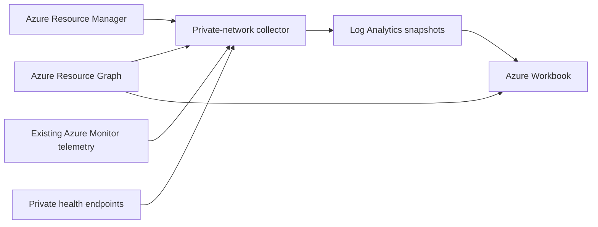

# Azure environment overview

A reusable Azure Workbook for discovering non-production resources, attributing them to environments, and showing Azure and application health. The approved [design](docs/superpowers/specs/2026-10-27-environment-overview-design.md), [plan](docs/superpowers/plans/2026-10-27-environment-overview.md) and [interactive concept](workbook-mockup.html) are included.

## Architecture



The one-minute collector reads the selected subscriptions, follows Resource Graph continuation tokens, applies attribution and health rules, and ingests a complete snapshot. It publishes a completion marker after the resource batches. The Workbook uses only runs whose distinct resource count matches that marker; it also recalculates freshness when queried. A direct Resource Graph panel provides independent inventory visibility.

The collector performs read-only Azure queries and HTTP GET checks; ingestion and its storage lease are its only writes. Bicep deployment is separate. No resources are deployed by generation, tests, or a collector run.

## Local preparation

Use Python 3.12 or newer. The unit suite and Workbook generator use only the standard library.

```bash
python -m unittest discover -s tests -v
cp config/project.example.json config/project.json
# Edit project.json for your tenant, subscriptions and workspace ARM IDs.
python -m workbook.build --config config/project.json --output dist/workbook.json
```

Import `dist/workbook.json` in Azure Monitor → Workbooks → New → Advanced editor, replacing the gallery JSON, then save it. For deployment templates, generate the artifact **before** compiling Bicep, as it is embedded at compile time.

The output contains workspace/subscription IDs and the project name, but not endpoint URLs, credentials or the complete collector configuration. The deploy-time projectConfig must correspond to the configuration used to generate the Workbook.

## Per-project configuration

Use [the example](config/project.example.json) and [schema](config/project.schema.json). Each independent deployment uses a stable, unique projectId and its own collector lock and identity. The first version supports Azure public cloud and one tenant per deployment.

- Environment and env tag keys are matched case-insensitively. Add exact aliases through tagAliases; broad fuzzy matching could mistake an unrelated tag for an environment.
- Values are trimmed and casefolded, preserving their original text. dev, test, qa, uat, staging and similar common labels are inferred as non-production; prod, production, prd and live as production; shared and common as shared. Other values remain visible as unclassified.
- classificationOverrides maps normalised values to production/nonproduction/shared/unclassified. Overrides are project configuration, not persistent browser edits.
- resourceOverrides maps full ARM IDs to environment values and can resolve conflicting explicit tags.
- parentOverrides maps a resource ARM ID to its containing resource ARM ID. Container Apps managedEnvironmentId and ordinary nested ARM parent IDs are recognised automatically. Resource group tags provide a further fallback.
- namingRules contains objects such as `{"token":"dev","environment":"dev"}`. Matches require non-alphanumeric boundaries; device does not match dev. Naming is opt-in because project conventions differ.
- Conflicting aliases at the same precedence become unassigned. Lower-precedence disagreements are shown as attribution issues. A missing direct tag stays visible even after fallback succeeds.
- The production filter hides confidently classified production from health summaries; it cannot identify arbitrary labels such as blue without a project override. Unclassified environments remain visible. The direct inventory panel includes all classifications.

## Health semantics and coverage

| Status | Meaning |
|---|---|
| Red | Confirmed endpoint failure, unavailable platform or active Sev 0–1 alert |
| Amber | Degraded platform or active Sev 2–3 alert |
| Grey | Required evidence missing, stale, insufficient or inaccessible |
| Green | All applicable required signals are freshly healthy |

Sev 4 alerts are informational. No-alert and provisioning-success states alone never establish green. An unsupported resource type stays in inventory with unknown health. Current adapters use Resource Graph Resource Health availability states and, when needed, Container Apps serving revision health. Resource Health is not available for every Azure resource type. Additional metrics-based policies should be added deliberately rather than inferring universal CPU/error thresholds.

Container Apps require application health evidence as well as platform evidence. Other types have application checks only when configured. Shared and unassigned resources use the same rules as environment resources. All resources count equally: red takes priority over amber, then grey, then green. Missing deployments are outside scope.

The snapshot stores current-state query time separately from endpoint observation time. After five minutes, old signals become unknown even if a previous result was red. A currently known failure still wins over an unrelated unknown signal. A new failed health query preserves resource rows and makes the affected signal unknown. Failed inventory collection leaves the previous complete snapshot visible until it ages; the missing/stale collection indication is not a claim of current coverage.

Workbook auto-refresh must be enabled each time it opens: **Auto refresh → 5 minutes**. This setting is not persisted by Azure. Refreshing the browser view does not trigger endpoint checks.

## Private endpoint onboarding

Automatic discovery supports HTTP readiness probes whose container port matches the app's ingress target port. It uses the app's ingress FQDN and probe path. TCP-only probes, sidecar ports, no-ingress services and multiple traffic-serving revisions require explicit project configuration. A missing routable check remains unknown.

For a custom endpoint, add an endpoints entry:

```json
{
  "resourceId": "/subscriptions/SUB/resourceGroups/RG/providers/Microsoft.App/containerApps/api",
  "checkId": "ready",
  "url": "https://api.internal/health/ready",
  "expectedCodes": [200],
  "tokenScope": "api://your-api/.default"
}
```

Omit tokenScope for unauthenticated health endpoints. For API keys, use `"headerEnv":{"X-Api-Key":"HEALTH_API_KEY"}` and supply that environment variable through the job's Key Vault secret references. Do not put tokens in URLs, queries, project files or inline headers. Probe definitions discovered from Azure can contain configured headers, but neither headers nor response bodies are written to health observations.

Explicit checks replace probe discovery for that resource. An endpoint's default success range is 200–299; discovered Container Apps probes retain Azure's 200–399 success convention. Redirects are never followed. HTTP 401/403 means an unknown authentication/configuration state; other unexpected statuses and timeouts are failures. DNS/TLS/connection errors are unknown because checker connectivity can be at fault. Known inactive revision observations are ignored; when multiple revisions serve traffic, health evidence must cover each revision. Latest-template probe inference is blocked if traffic serves an older revision.

## Reuse existing endpoint telemetry

Configure existingEndpointQueries instead of endpoints for resources already monitored inside the network. Each source needs a workspaceResourceId, a query, and a checks array listing the expected resourceId/checkId pairs. The query must return **ResourceId, CheckId, Outcome, TimeGenerated, Reason**; Outcome is pass/fail/unknown and TimeGenerated is the original observation timestamp with a UTC offset. Do not use ingestion time as evidence time. Return only the latest samples; the collector further reduces by check ID. Missing expected checks become unknown. Only explicitly listed checks are accepted.

The collector needs workspace read/query access for these sources. Setting discoverReadinessProbes=false and using existingEndpointQueries avoids HTTP probing; the collector still runs to discover resources and combine Azure health. You can also use an existing scheduler instead of the supplied Container Apps Job, provided it runs the same collector and honours its lock and lifetime.

## Deployment

Prerequisites: Azure CLI with Bicep and Resource Graph extension, a test subscription, an existing Log Analytics workspace **in the deployment resource group**, and an existing Container Apps environment that can resolve and reach the target private endpoints. The job, workspace and managed environment must use a compatible Azure region. Build/publish the image to a registry you control; image publication and Azure deployment are explicit external actions.

After choosing a test scope, build the local artifacts:

```bash
python -m workbook.build --config config/project.json --output dist/workbook.json
az bicep build --file infra/main.bicep
docker build -t YOUR_REGISTRY/environment-overview:VERSION .
```

Create an ARM parameter file with workspaceName, containerAppsEnvironmentId, checkerImage, registryServer and projectConfig. Set projectConfig to the same JSON used by the generator. Run `az deployment group what-if` with that file before `az deployment group create`. No deployment has been performed by this project setup.

Bicep creates the Workbook, custom Log Analytics table, data collection endpoint/rule, user-assigned identity, storage lease and scheduled job. It does not create a VNet, DNS setup, Container Apps environment, workspace or registry. Subscription Reader role creation is explicitly opt-in through assignDiscoveryRoles (default false). Other role assignments are limited to the collector's DCR and lock container.

The ingestion and lease endpoints are authenticated Azure public service endpoints by default; this does not expose monitored applications. Estates requiring private ingestion/storage must add private endpoints, DNS and the corresponding Azure Monitor Private Link configuration before enabling the job. Ensure outbound reachability to ARM, Entra ID, Resource Graph, Log Analytics, ingestion and lease storage.

The scheduler uses one replica, no execution retries and a 55-second replica timeout. A 60-second blob lease prevents concurrent collectors; the Python entrypoint enforces its own 55-second process lifetime. Large estates may exceed this window: narrow scopes or deploy separate project IDs. Failed runs never publish a complete manifest. Increasing the timeout requires lease renewal, not merely changing the job setting.

## Permissions

| Identity | Required access |
|---|---|
| Collector | Reader over each intended inventory subscription (or equivalent explicit scoped reads); no resource modification rights |
| Collector | Monitoring Metrics Publisher on the created DCR (assigned by Bicep) |
| Collector | Storage Blob Data Contributor on the lock container (assigned by Bicep) |
| Collector | Log Analytics query access to existing telemetry workspaces, when configured |
| Collector | API-specific application role or Key Vault secret read access when endpoint authentication needs it |
| Collector registry identity | AcrPull on the selected ACR, granted separately |
| Workbook viewer | Workbook read, workspace query access and subscription inventory read for direct Resource Graph panels |
| Deployer | Permission to deploy listed resources and create the listed role assignments |

RBAC can hide resources even when Resource Graph succeeds. The Workbook displays this limitation. Compare the direct inventory count against an identity with known coverage during onboarding; subscription metadata access does not prove access to every resource.

## Verification and limits

Run `python -m unittest discover -s tests -v` for local behaviour and artifact tests. The Bicep compilation test skips explicitly if the compiler is absent. Run opt-in read-only Azure checks with `OVERVIEW_LIVE=1 OVERVIEW_CONFIG=config/project.json python -m unittest discover -s tests/live -v` after installing requirements and authenticating. See [the live acceptance checklist](tests/live/acceptance.md) for deployment/ingestion and browser validation.

The direct Resource Graph list is capped at 1,000 rows and is labelled accordingly; the separate count is not capped. The collector paginates inventory. Workbook health grids display at most 10,000 rows; narrow filters for larger scopes. Summaries count the full selected snapshot. Queries use a two-day snapshot lookback; no data means missing monitoring, never healthy. Snapshot ingestion every minute has Azure ingestion/storage charges proportional to inventory size and retention.

Local verification does not validate Azure API schemas, Bicep resource-provider validation, Log Analytics KQL execution, ingestion delivery or Workbook rendering. Consult [verification evidence](docs/verification.md) for what was actually run.

## References

- [Workbook data sources](https://learn.microsoft.com/en-us/azure/azure-monitor/visualize/workbooks-data-sources)
- [Workbook auto-refresh limitations](https://learn.microsoft.com/en-us/azure/azure-monitor/visualize/workbooks-configurations#set-up-auto-refresh)
- [Resource Graph supported resources and freshness](https://learn.microsoft.com/en-us/azure/governance/resource-graph/overview)
- [Container Apps health probes](https://learn.microsoft.com/en-us/azure/container-apps/health-probes)
- [Logs ingestion API](https://learn.microsoft.com/en-us/azure/azure-monitor/logs/logs-ingestion-api-overview)
